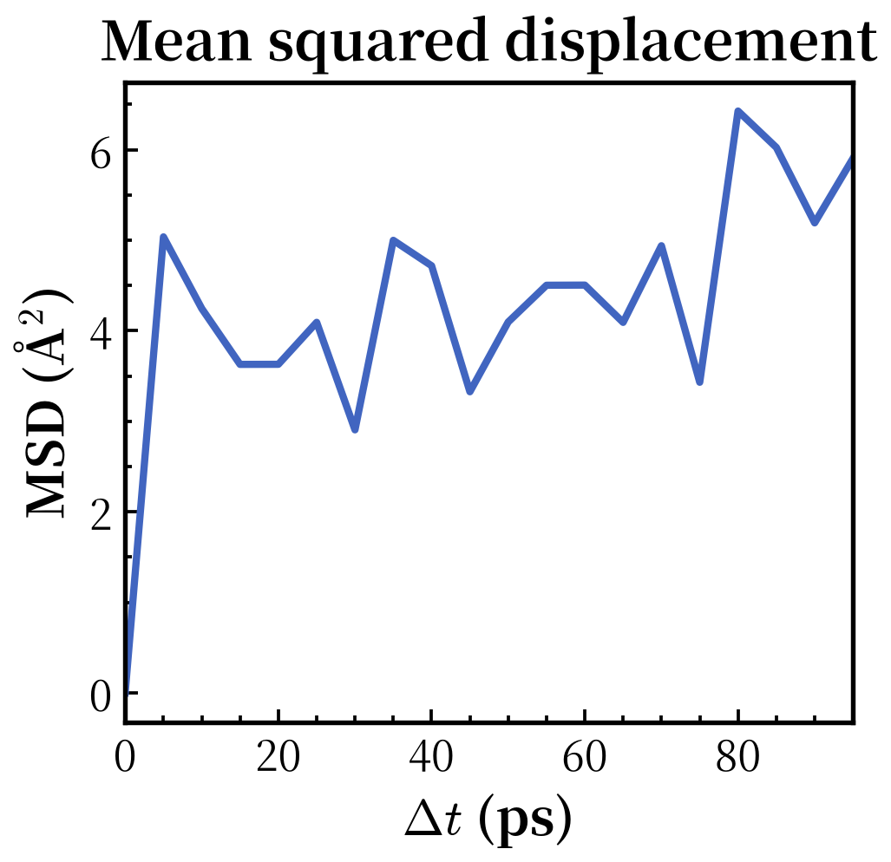
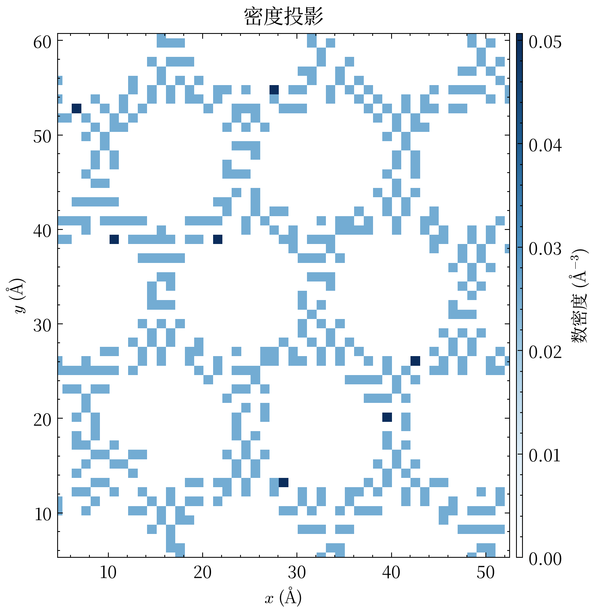
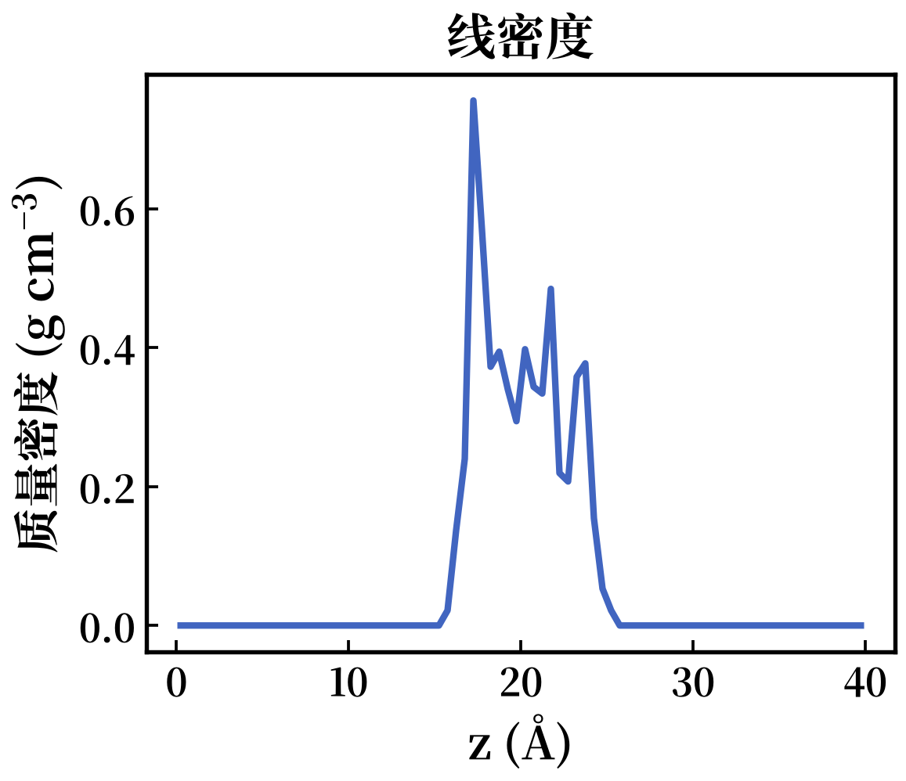
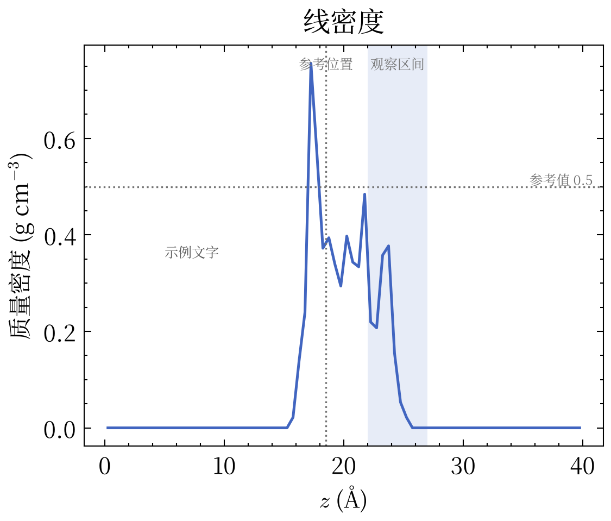
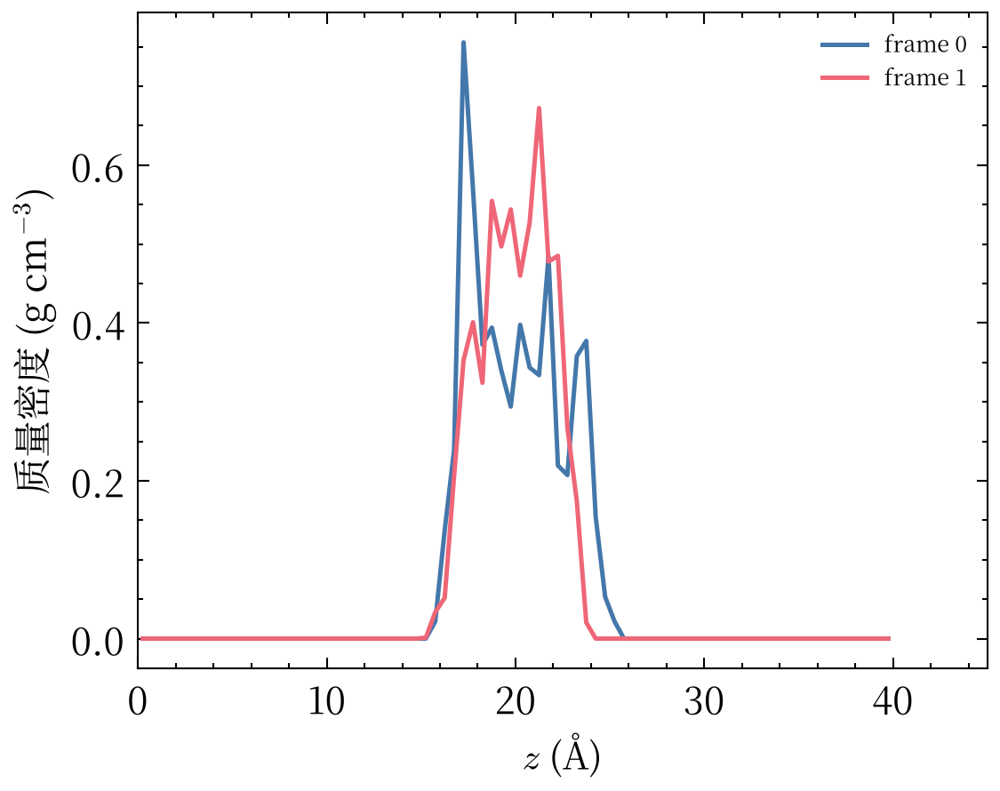

# mdanal

从 LAMMPS 轨迹得到可调整的科研图：先算一次数据，之后改语言、颜色、范围、标注和格式时只重绘，不重新扫轨迹；需要新算法时，把分析写成一个插件。



## 30 秒开始

```bash
pip install -r requirements.txt
pip install -e .                 # 可选；不装就运行 python main.py
python main.py check --system example/quickstart
python main.py run   --system example/quickstart --out /tmp/mdanal-demo --force
# 打开 /tmp/mdanal-demo/msd/figures/msd.png
python main.py replot --from /tmp/mdanal-demo --out /tmp/mdanal-demo-en \
  --lang en --format svg --config example/recipes/plot-en.yaml
```

`example/quickstart` 用仓库自带的 tiny 数据，只跑一个 MSD；它不是研究结论，只用于把流程跑通。完整步骤见 [首次使用](docs/getting-started.md)。

中文图需要系统安装 `Noto Serif CJK SC`；缺字体时 `run` 会直接报错，见 [排错](docs/troubleshooting.md#字体)。检查：

```bash
python -c "from mdanal.plot.chart import missing_fonts; print(missing_fonts())"
```

## 我想做什么

| 想做的事 | 去哪里 |
|---|---|
| 先看看能画什么 | [图库](docs/gallery.md) |
| 从仓库小算例画第一张图 | [首次使用](docs/getting-started.md) |
| 换成自己的轨迹、原子类型和选择组 | [输入与配置](docs/configuration.md) |
| 改中英文、颜色、尺寸、范围、格式 | [绘图与重绘](docs/plotting.md) |
| 选色板或自定义颜色 | [颜色](docs/colors.md) |
| 加界面线、区间、说明文字 | [绘图与重绘：标注](docs/plotting.md#标注) |
| 把多个体系画在一起 | [多体系对比](docs/compare.md) |
| 做 YAML 表达不了的特殊图 | [Python 自由绘图](docs/plotting.md#python) |
| 新增分析或接入第三方库 | [插件手册](docs/plugins.md) |
| 遇到报错 | [排错](docs/troubleshooting.md) |

手册入口在 [docs/index.md](docs/index.md)；每一页只讲一个主题，README 只保留入口。

## 数据流

```text
data.lmp + dump + system.yaml
          │ run
          ▼
  CSV + plot.json + 初次 PNG
          │
          ├── plot.yaml + replot ──> 新图目录（不读轨迹）
          │
多个 run 结果 + compare.yaml ──> 对比图 + 对齐后的表
          │
CSV / 自己的数组 + Python/chart ──> 自由绘图
```

- `run` 执行分析并读轨迹；`check` 也会加载体系做校验，但不计算；每条分析保存 `plot.json` 和标准 CSV；
- `replot` 只读 `plot.json` + CSV，切换语言/颜色/范围/标注/格式时不用重算；
- `compare` 只读多个 `run` 的输出；
- 表是稳定机器列名，图内文字才随 `--lang` 改变。

## 能画什么

八种内置分析：密度投影、线密度、径向分布、氢键数量、氢键类型分布、氢键寿命、均方位移、流速剖面。缩略图和科学含义见 [图库](docs/gallery.md) 与 [分析说明](docs/analyses.md)。

| 密度投影 | 线密度 |
|---|---|
|  |  |

| 带标注的线密度 | 多体系对比 |
|---|---|
|  |  |

## 重要边界

- 一次 `run` 处理一个体系；多体系在 `compare` 阶段叠图。
- `density`/`lineardensity` 在盒子变化时只算首帧并警告；`msd` 的连续视图要求每帧位移小于半盒；氢键寿命需要足够密的采样。
- 速度剖面在首帧参考盒坐标中平均；误差是未校正时间相关性的样本标准误。
- `palette` 只改未显式设色的曲线；氢键部分图、密度连续色标、标注颜色仍单独设置。
- 当前没有密度色标范围、逐条标注样式、论文级误差估计；见 [排错与限制](docs/troubleshooting.md#限制)。
- 旧结果没有 `plot.json` 时不能重绘，需要重新 `run`。

## 插件与开发

分析是 `src/mdanal/analyses/` 下的一个 `.py` 文件，`run` 算数、`figures` 只画图；不从主执行器里特判某个库。模板、声明表、上下文和第三方适配步骤见 [插件手册](docs/plugins.md)。

```bash
python main.py list
python main.py check-analysis
python main.py check-analysis --system example/quickstart
python -m pytest
python -m pytest tests/analyses
```

`docs/analysis-audit.md` 是开发审计资料，不是用户手册。

示例配置在 `example/`：`quickstart/system.yaml`、`system.yaml`、`plot.yaml`、`recipes/`、`analysis_template.py`、`plot_from_data.py`；文档中的图由 `scripts/build_docs_assets.py` 从真实结果生成。
