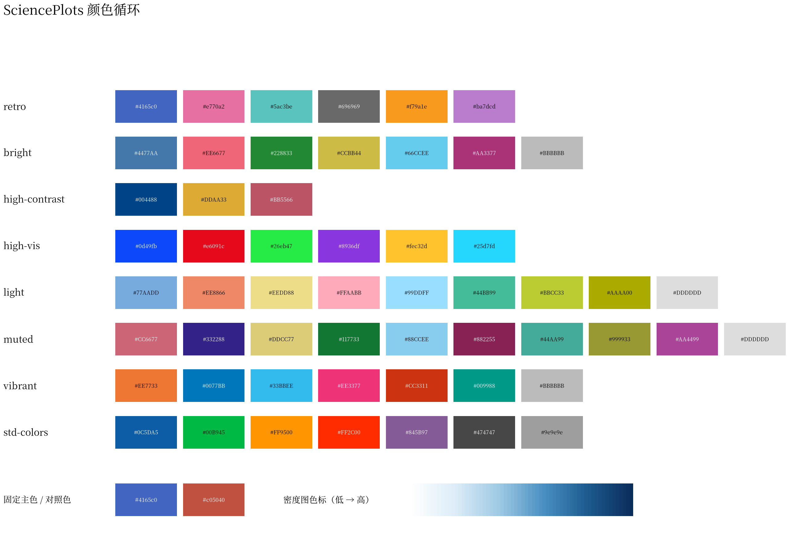
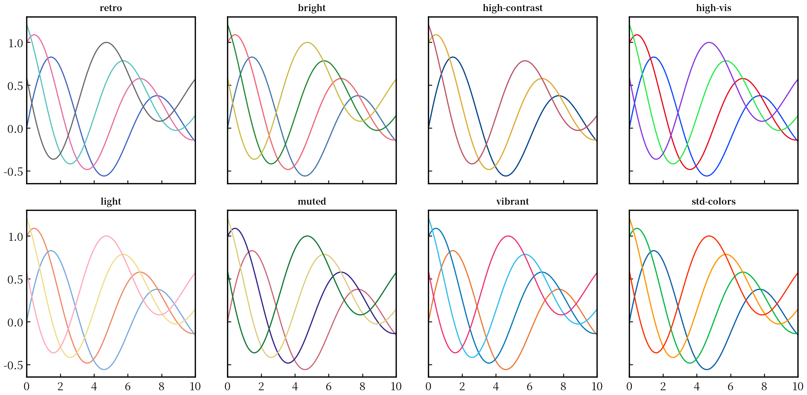

# 颜色

颜色分两层：**离散曲线循环**（`palette`）和**连续密度色标**（density 自己的 colormap）。两者不是一回事。

## 1. 当前色板



图片是静态展示素材；颜色循环由 `plot.palette` 选择，连续色标由 density 参数控制。

不写 `palette` 时使用 mdanal 主题色；也可显式选择八套命名色板：

| 名称 | 颜色数 | 颜色（按顺序） |
|---|---:|---|
| `mdanal`（默认） | 6 | `#4165c0` `#c05040` `#4a90c2` `#d08a3e` `#5b9e7a` `#8a6bb0` |
| `retro` | 6 | `#4165c0` `#e770a2` `#5ac3be` `#696969` `#f79a1e` `#ba7dcd` |
| `bright` | 7 | `#4477AA` `#EE6677` `#228833` `#CCBB44` `#66CCEE` `#AA3377` `#BBBBBB` |
| `high-contrast` | 3 | `#004488` `#DDAA33` `#BB5566` |
| `high-vis` | 6 | `#0d49fb` `#e6091c` `#26eb47` `#8936df` `#fec32d` `#25d7fd` |
| `light` | 9 | `#77AADD` `#EE8866` `#EEDD88` `#FFAABB` `#99DDFF` `#44BB99` `#BBCC33` `#AAAA00` `#DDDDDD` |
| `muted` | 10 | `#CC6677` `#332288` `#DDCC77` `#117733` `#88CCEE` `#882255` `#44AA99` `#999933` `#AA4499` `#DDDDDD` |
| `vibrant` | 7 | `#EE7733` `#0077BB` `#33BBEE` `#EE3377` `#CC3311` `#009988` `#BBBBBB` |
| `std-colors` | 7 | `#0C5DA5` `#00B945` `#FF9500` `#FF2C00` `#845B97` `#474747` `#9e9e9e` |

同一组多曲线数据在八套色板下的效果：



`mdanal` 是平台默认主题，前两色就是固定主色/对照色；其余命名色板来自安装的 **SciencePlots 2.2.2**。

## 2. 怎么用

在 Panel 的 `plot` 里写 `palette`：

```yaml
panels:
  - source: A
    pack: msd
    product: msd-raw
    select: {group: water}
    plot:
      palette: bright
```

自定义颜色：

```yaml
plot:
  palette: ["#0077BB", "#EE7733"]
```

`palette` 只影响未显式设色的曲线；`hbond-count`/`hbond-type`/`density-2d` 的固定色或连续色标不跟随。完整输入见 [输入与配置](configuration.md)。

<a id="生效范围"></a>

## 3. 生效范围

| 图 | `palette` 是否生效 | 说明 |
|---|---|---|
| `rdf` / `msd-raw` / `density-line` / `velocity` | 是 | 数据曲线未显式设色，使用循环色；velocity 默认仍以蓝色为首色 |
| `hbond-count` | 否 | 曲线显式使用固定主色 |
| `hbond-lifetime-continuous` | 否 | 单曲线和标记显式使用主色 |
| `hbond-lifetime-intermittent` | 否 | 单曲线和标记显式使用对照色 |
| `hbond-type` | 否 | 条形图显式使用主色 |
| `density-2d` | 否 | 使用白→砖红→蓝连续色标；色标由分析参数 `cmap/colors/vmin/vmax` 控制 |
| `compare` | 是（`compare.plot.palette`） | 不配置时按 mdanal 主题；按来源分配颜色/线型 |
| 自己的 `chart.line` | 是 | 未显式写 `color=` 时使用循环色 |

固定主色/对照色：

| 名称 | 值 | 用在哪 |
|---|---|---|
| primary | `#4165c0` | hbond-count、hbond-lifetime-continuous、hbond-type、部分标记 |
| secondary | `#c05040` | `hbond-lifetime-intermittent` |

两个 lifetime 单曲线产品固定使用 primary/secondary，**不**跟随 `palette`。

## 4. 密度色标

密度图使用单独的白→砖红→蓝连续色标（`cmap: mdanal`），不受曲线 `palette` 影响。色标属分析参数，不是 `plot` 覆盖：

```yaml
figures:
  - name: density
    panels:
      - source: A
        pack: density
        product: density-2d
        select: {group: water_o}
        compute:
          delta: 1.0
          cmap: viridis          # 或 mdanal
          colors: ["#fff", "#c05040", "#4165c0"]  # 可选，覆盖 cmap
          vmin: 0.0
          vmax: 0.8
        plot: {plane: xy}
```

这些是 `density` 的 compute 参数，改变后需要重新 `render`；色条样式则用 `plot.cbar_width`（默认 `"6%"`）和 `plot.cbar_frame`（默认 `false`）控制，`replot` 可以覆盖。色条刻度线隐藏、刻度数字加粗，`number density (Å⁻³)` 标签保留。`density` 的多面板共享 `vmin/vmax`，每个 panel 的色标高度对齐自身纵轴。


如果要逐 panel 用不同色标或逐条标注样式，仍需要 Python 读表重画；`plot.palette` 不是密度 colormap。

## 5. 不是“色盲保证”

上表只描述颜色顺序，不保证每套色板都色盲友好，也不把 “nature/ieee” 当作可读性认证。多曲线时优先看实际预览和线型/标记的区分。

下一步：[图库](gallery.md) 或 [绘图与重绘](plotting.md)。
