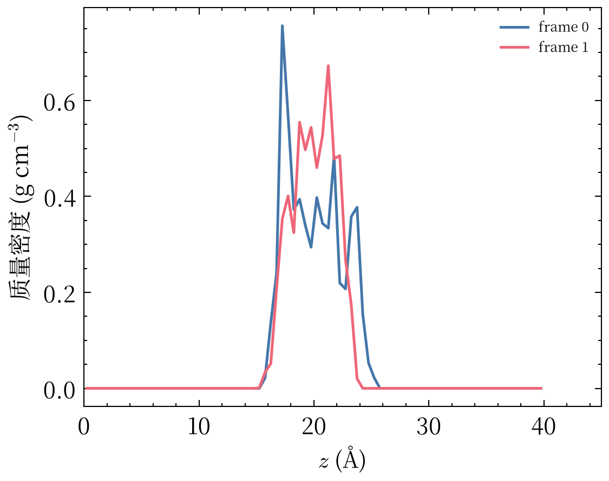

# 多体系对比

`compare` 只读多个 `run` 的输出（表 + 溯源），不重读轨迹、不重算分析；把参数兼容的一维结果对齐叠图。当前内置分析都通过插件自己的 `render_panel` 绘制，`compare` 只负责选表、对齐和构造曲线。

## 1. 前置条件

- 每个体系都已经 `run` 过，目录里有 `manifest.csv`、`provenance.json` 和分析子目录；
- 各体系的同一分析**参数相同**（例如都 `dim: z`、`binsize: 0.5`）；不同参数会报错；
- 只有一维曲线能叠；二维密度图各自出图。

## 2. 空间对齐

```yaml
items:
  - {root: runs/test1/out, label: test1}
  - {root: runs/test5/out, label: test5, anchor: {z: 22.0}}
figure:
  analysis: lineardensity
  align: left
  palette: bright
  xlim: [0, 45]
  ylim: [0, 1.2]   # 可选：给图例留 y 方向空间
out: compare
```

```bash
python main.py compare --config compare.yaml --out compare-out
```

- `align`：`left`（盒下角 → 0）、`center`（盒心 → 0，默认）或数值；也可写 `{z: 22.0}` 逐轴指定；
- `anchor`：只对某个体系覆盖对齐位置，单位是该轴数据单位；
- `xlim`：显示范围，不改表；
- `palette`：按体系分色；多列结果按线型区分，图例写成「体系 · 列名」。

<a id="时间轴"></a>

## 3. 时间轴

时间偏移只用于**非盒坐标、列名以 `_ps` 或 `_ns` 结尾**的横轴，例如 MSD：

```yaml
items:
  - {root: runs/a/out, label: 0 ns,  t_offset: 0}
  - {root: runs/b/out, label: 5 ns,  t_offset: 5}
figure:
  analysis: msd
  xlim: [0, 0.095]
out: compare-msd
```

`t_offset` 是加到该体系横轴上的数值，单位跟横轴（MSD 新表是 ns，旧快照可以是 ps）；它不会把不同体系的绝对时间混在一起，只是把曲线的起点平移。`xlim` 也只按当前表单位写。

**空间轴不能加 `t_offset`**。`lineardensity` 的 `z_angstrom` 是盒坐标，写了会报：

```text
t_offset 只能用于时间轴...当前横轴是 'z_angstrom'
```

## 4. 多 Panel 一次输出

一个 `compare` 也可以组织多个 Panel；每个 Panel 仍由对应插件的 `render_panel` 绘制。

```yaml
items:
  - {root: runs/tma/out, label: TMA}
  - {root: runs/pip/out, label: PIP}

figure:
  align: left
  layout:
    ncols: 3
  panels:
    - {analysis: lineardensity-x, title: x, y: [mass_density_g_cm3], ylim: [0, 0.26]}
    - {analysis: lineardensity-y, title: y, y: [mass_density_g_cm3], ylim: [0, 0.26]}
    - {analysis: lineardensity-z, title: z, y: [mass_density_g_cm3], ylim: [0, 0.26]}
```

- 每个 Panel 的 `analysis` 是某个 run 里的实际输出目录；
- 不同 Panel 可以使用不同分析/方向；
- 同一 Panel 内每个 item 必须使用相同分析、相同参数；
- `layout.ncols` 只控制一行放几个 Panel；
- 输出是一张 `compare.png`，表按 Panel 分别写到 `tables/`；同一 analysis/table 被多个 Panel 引用时，第二张起为 `...__panel2.csv`，不会覆盖。
- 氢键 `hbond_count` 已声明 `COMPARE`，可以直接叠图；`hbond_type` 没有 compare 声明。

## 5. 输出

```text
COMPARE/
├── lineardensity.png
├── tables/lineardensity_z.csv
└── provenance.json
```

- 合并表含 `item`、对齐后的 `x` 和各列；
- `provenance.json` 记录每个体系的平移量、`t_offset`、语言、palette、xlim 和每个 Panel 实际引用的表；
- 非空输出默认拒绝，`--force` 允许覆盖；输出不能等于/位于输入结果目录内。

## 6. 示例图



这张图用同一体系的两帧演示对齐，不是多体系科学结论。真实使用时把 `items[].root` 换成自己的两个 `run` 输出；完整字段见 [`example/recipes/compare.yaml`](../example/recipes/compare.yaml)。

## 7. 常见错误

- 两个体系的 `analysis` 目录名不同：`figure.analysis` 要写实际目录名（含 tag）；
- 参数不同：重跑成相同 `dim`/`binsize`/`range` 等；
- `t_offset` 加在空间轴：删掉，或改用时间轴分析；
- 输出目录在输入目录里：换独立目录；
- 二维密度：不能 compare，直接看各自图。

下一步：[分析说明](analyses.md) 或 [排错](troubleshooting.md)。
