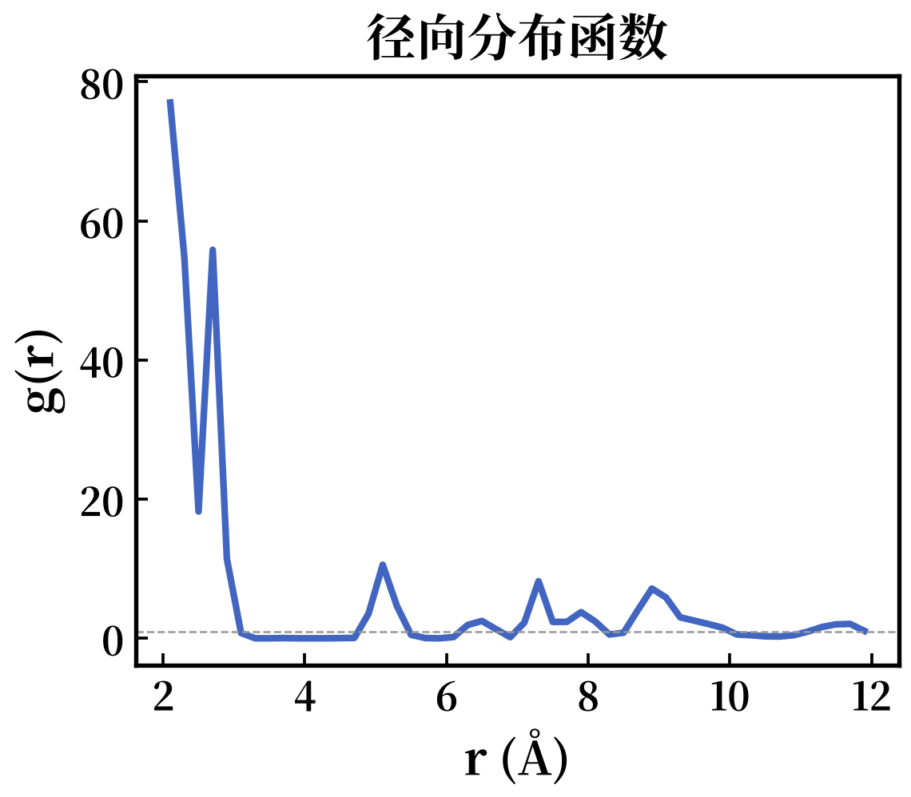
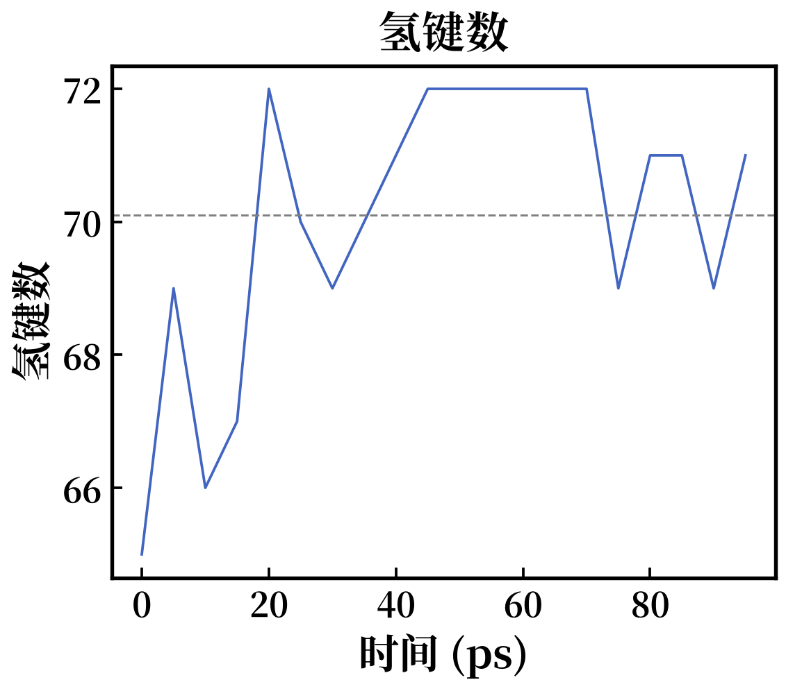
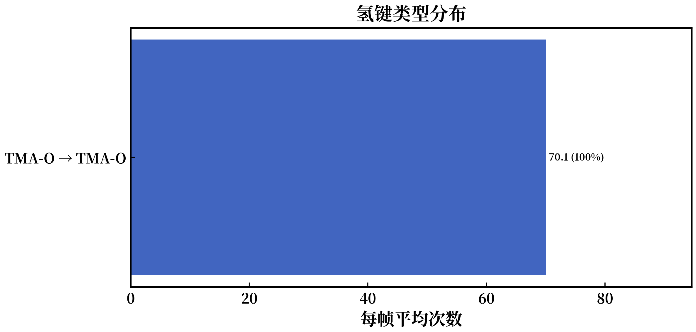
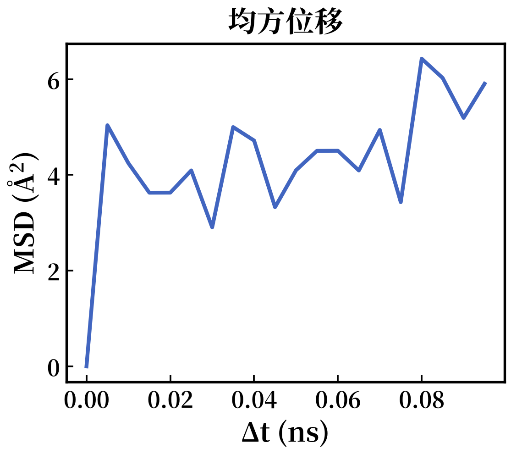
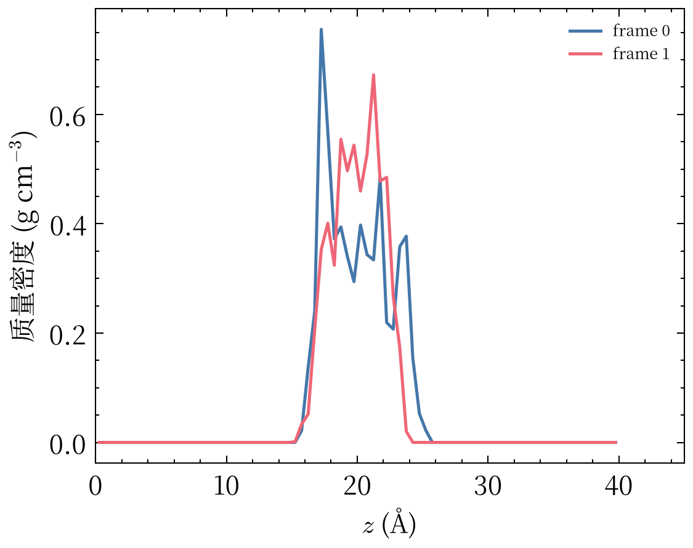
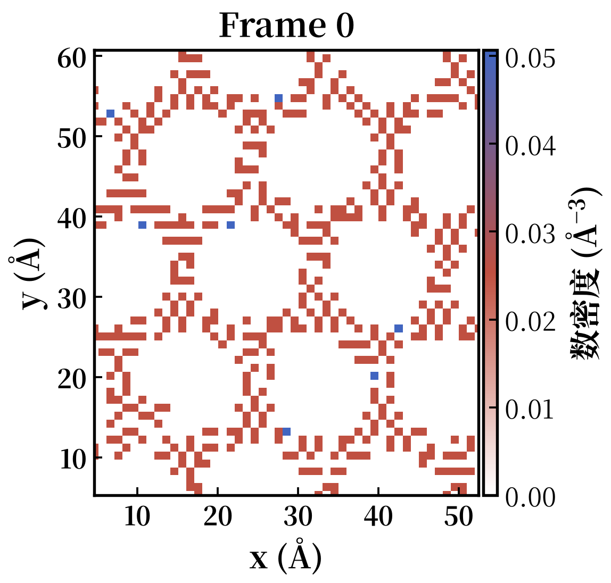
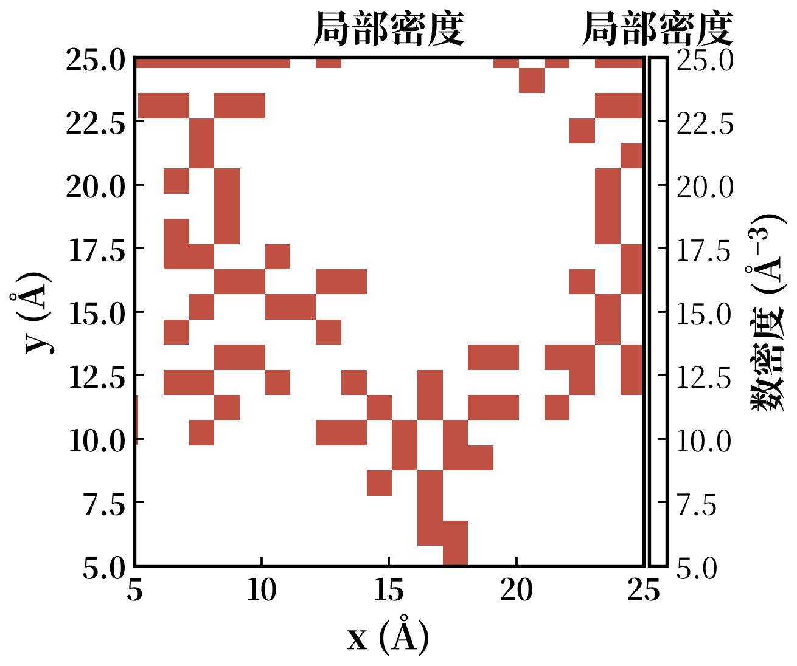

# 图库与改图案例

所有图都由当前代码在 tiny 数据上实际生成；tiny 的盒子变化、寿命采样等警告见 [首次使用](getting-started.md#tiny-示例的边界)。这里展示“能画什么”和“怎么改”，不作科学结论。

## 八种内置分析

### 密度投影


沿一个轴求和后投影到另外两轴；tiny 的密度图能看出蜂窝模板的孔。分析说明见 [density](analyses.md#density)。

### 线密度


沿指定轴的质量密度（同时输出三个轴的表）。tiny 盒子在变，程序只使用首帧。

### 径向分布



两组原子间的 g(r)；tiny 的尖峰包含分子内 O–O 相关，不能直接当液体结构因子。

### 氢键计数



每帧氢键数；横轴是时间，纵轴是计数。

### 氢键类型



按供体/受体类型统计；需要 `naming` 才能得到元素/分子标签。

### 氢键寿命


连续/间歇存活曲线，1/e 交叉点标注。tiny 的帧间隔 5 ps，程序会提示寿命不可信。

### 均方位移


`dt_ns` 对 `msd_A2`；默认只画 raw。需要拟合线/D 时在上层配置 `derive.fit` 并选择 `figures.fit`，或对已有表用 `mdanal derive`。

### 流速剖面


按原盒坐标分箱的实验室系速度；空 bin 断线，误差是未校正时间相关性的样本标准误。

## 改图案例

五个案例都从已有结果重绘，**不重新扫描轨迹**。命令默认在仓库根目录执行；`OUT` 指你的 run 输出目录。

### 1. 中英文切换

| 中文 | 英文 |
|---|---|
|  |  |

- 配置：[`example/recipes/plot-en.yaml`](../example/recipes/plot-en.yaml)
- 命令：
  ```bash
  python main.py replot --from /tmp/mdanal-demo --out /tmp/mdanal-demo-en \
    --config example/recipes/plot-en.yaml
  ```
- 输出：`/tmp/mdanal-demo-en/msd/figures/msd.png`
- 改了：`defaults.lang`、标题和轴标签；**不需要重算**。
- 注意：用户自己写的字符串不会自动翻译，双语映射要自己提供 `zh/en`。

### 2. 换曲线色板

| `retro` | `bright` |
|---|---|
|  |  |

- 配置：[`example/recipes/compare.yaml`](../example/recipes/compare.yaml)（`figure.palette`）
- 命令：
  ```bash
  python main.py compare --config example/recipes/compare.yaml \
    --out /tmp/mdanal-compare
  ```
  需要先把 `items[].root` 改成两个真实 run 输出；图中的两条曲线来自同一体系两帧，仅演示对齐和配色。
- 输出：`/tmp/mdanal-compare/lineardensity.png`
- 改了：`figure.palette`；**不需要重算**。
- 注意：`hbond`、`hbond_lifetime`、密度色标不跟随 `palette`，见 [颜色](colors.md#生效范围)。

### 3. 裁剪显示范围

| 原图 | `xlim/ylim` |
|---|---|
|  |  |

- 配置：[`example/recipes/plot-clip.yaml`](../example/recipes/plot-clip.yaml)
- 先跑一次完整 tiny（或你自己的 `OUT`），再：
  ```bash
  python main.py replot --from OUT --out /tmp/density-clip \
    --config example/recipes/plot-clip.yaml
  ```
- 输出：`/tmp/density-clip/density-xy/figures/density_xy.png`
- 改了：`plot.xlim`、`plot.ylim`、标题；**不改 CSV**。
- 注意：`xlim` 不会补出未计算范围的数据；RDF 的 `range` 在 `system.yaml` 里，是计算参数。

<a id="标注"></a>

### 4. 四种标注

| 原图 | 标注后 |
|---|---|
|  |  |

- 配置：[`example/recipes/plot-annotate.yaml`](../example/recipes/plot-annotate.yaml)
- 命令：
  ```bash
  python main.py replot --from OUT --out /tmp/annotated \
    --config example/recipes/plot-annotate.yaml
  ```
- 输出：`/tmp/annotated/lineardensity/figures/lineardensity_z.png`
- 改了：`vline`、`span`、`hline`、`text`；**不需要重算**。
- 注意：`horizontal/vertical` 是图轴数据坐标；`x/y/z` 是旧物理轴匹配。标注颜色/字号当前固定。

### 5. 多体系对齐


- 配置：[`example/recipes/compare.yaml`](../example/recipes/compare.yaml)
- 命令：
  ```bash
  python main.py compare --config example/recipes/compare.yaml --out /tmp/compare
  ```
- 输出：`/tmp/compare/lineardensity.png`
- 改了：`items`、`align`、`xlim`、`palette`；**不需要重算**。
- 这张图用同一体系的两帧演示对齐；真实多体系对比把 `items[].root` 换成各自 `run` 的输出。空间轴不能加 `t_offset`，时间轴示例见 [多体系对比](compare.md#时间轴)。

下一步：[分析说明](analyses.md) 或 [多体系对比](compare.md)。
