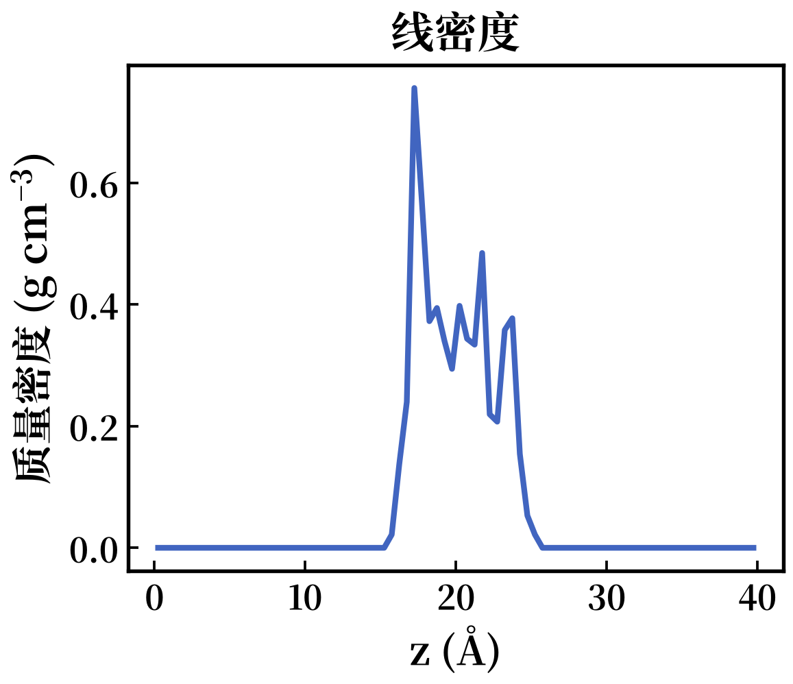
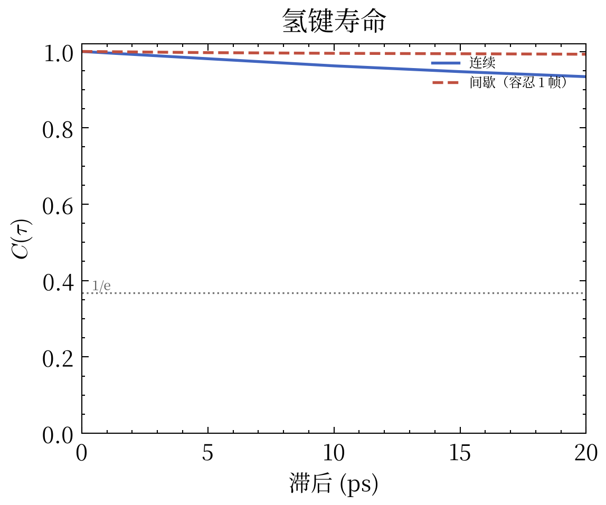
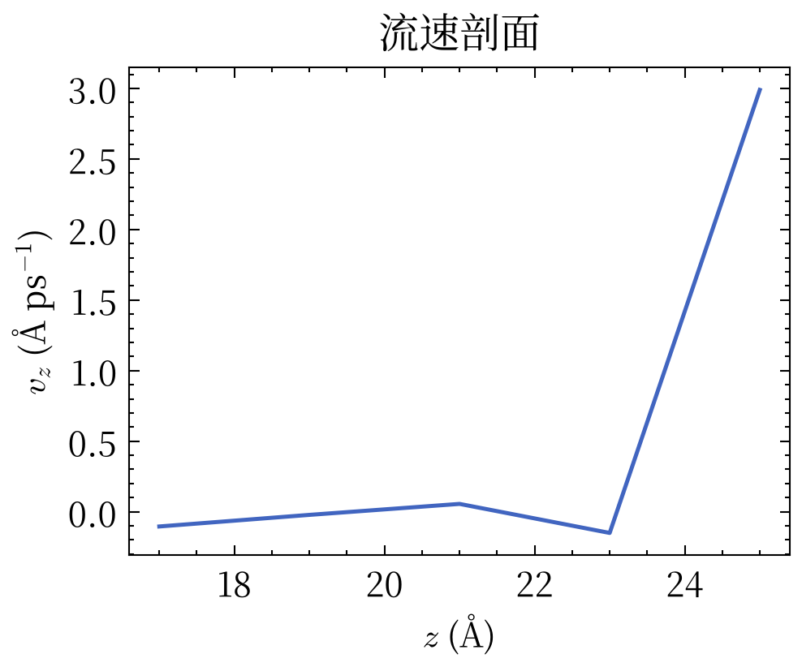

# 图库

这些图用于展示形态，不是研究结论。当前输入示例见 [example/figures.yaml](../example/figures.yaml)。

## 密度

| 2D 密度 | 线密度 |
|---|---|
|  |  |

`density-2d` 用 `plot.plane` 选 xy/xz/yz；`density-line` 用 `plot.axis` 选轴。两者同属 `density` 图包，3D 网格只算一次。

## 氢键

| 计数 | 类型 |
|---|---|
|  |  |

| 寿命 |
|---|
|  |

三个产品共享一次 HBA；`hbond-type` 需要 `naming`。

## MSD

`msd-fit` 需要 `derive.fit.window_ns`；`msd-rdc` 需要 `derive.rdc`。

## RDF / 速度

| RDF | 速度 |
|---|---|
|  |  |

## 多体系

2D 密度用多个 Panel 并排；曲线用 `compare`。见 [多体系对比](compare.md)。
