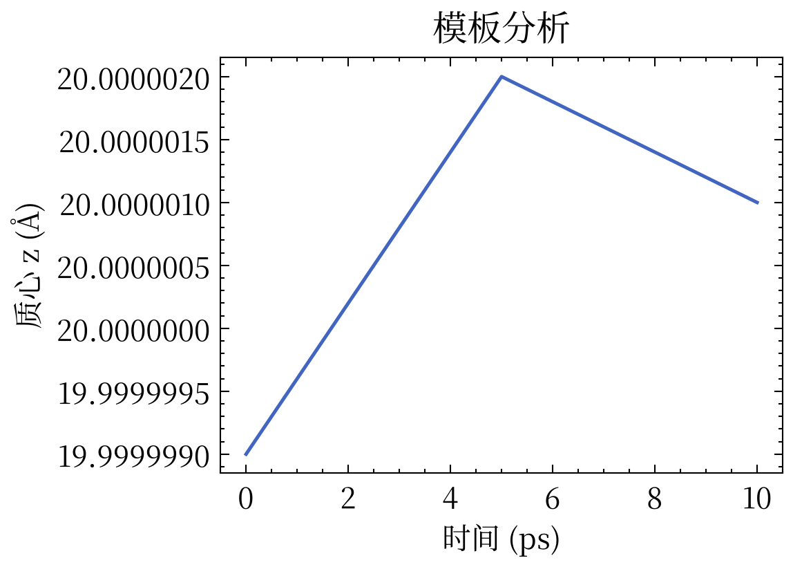

# 插件手册

插件 = `src/mdanal/analyses/` 下的一个 `.py` 文件。文件名就是分析名，放进目录就会被发现，不需要改注册表。

三条路径：

1. **复制模板跑通**：适合第一次写插件；
2. **自己写算法**：`run` 算数，`figures` 画图；
3. **改造第三方分析**：把已有库调用映射到 `run`/`figures`。

## 1. 先看契约

```python
run(run_ctx) -> dict[str, pandas.DataFrame]
meta(run_ctx, tables) -> dict                 # 可选
figures(plot_ctx, tables) -> list[tuple[str, Figure]]  # 可选，旧接口
render_panel(plot_ctx, request) -> Panel      # 可选，新接口
```

- `run`：唯一可以访问轨迹、原子组和选择的地方；
- `meta`：只导出结果摘要，在绘图前执行；
- `figures`：旧绘图接口，只使用已保存的表和摘要，不读 Universe、不补算、不落盘；
- `render_panel`：新 Panel 接口。插件只负责 Panel 的呈现（坐标轴、注释、参考线、标点、色标），平台负责选择数据、排版和保存；
- 没有 `figures` 的数据分析是合法的；
- 图由框架统一保存和关闭；一个插件可以返回多张图。

`render_panel` 的 `request` 是 `plot.specs.PanelRequest`，其中 `series` 是 `Series` 列表，每个 `Series` 含 `Curve`（一维曲线）或 `Field`（二维场）。原生运行和 `compare` 多曲线叠加都调用同一个 `render_panel`。尚未迁移的插件继续走旧 `figures` 路径。

### 声明参考

| 声明 | 要点 |
|---|---|
| `SLOTS` | 非空、不重复的槽位序列；顺序与 system.yaml 的 `sel` 对应 |
| `PARAMS` | 必须存在，可为 `{}`；有参数时写 `type/default/unit/min/max/choices/help`；单位字符串不会自动换算 |
| `LABELS` | `zh`/`en` 两套图内文字；公共标签和 `window` 占位符来自 `labels.yaml` |
| `COLUMN_LABELS` | 机器列名 → 展示标签；compare 使用 |
| `COORDINATES` | `in_box`/`continuous`/`any`；`any` 是“无特殊连续需求”，当前实际按 `in_box` 运行，不代表任意几何 |
| `GEOMETRY` | `{cell: orthorhombic/any, periodicity: full/xy/xz/yz/any}`；`xy` 表示只要求 x/y 周期，`any` 表示作者自行处理所有方向 |
| `REQUIRES` | 当前已识别 `velocities`；不要写未识别的字符串假装检查了其他能力 |
| `PACKAGE` | 外部包名和最低版本；不是安装器 |
| `MUTATES_POSITIONS` | 会就地改坐标时必须 `True`；仍要避免污染其他分析 |
| `COMPARE` | 表名、x、y、`box_axis`；不是所有分析都适合一维叠图；声明后 `compare` 可读该分析 |
| `render_panel` | 可选；有它时 `compare` 用插件自己的 Panel 模板，而不是通用曲线绘制 |

未声明 `GEOMETRY` 的旧插件按保守默认 `orthorhombic/full` 检查：遇到非正交或非全周期输入会打印非物理警告并继续，不会静默；定量结果仍要求满足声明。内置 density/lineardensity/velocity 声明 `xy`，RDF/氢键家族声明 `full`，msd 声明 `any`。

### 输出契约

- 表名自己定；输出目录名是 `name[-tag]`，和表名/图名不是一回事；
- 列名用稳定 ASCII，明确单位；
- 支持 float/int/bool/str（对象列必须是字符串或空）；NaN 和空表要有定义；
- `meta`/`extras` 只能放 JSON 可表示的小数据；
- 图名唯一、不能含路径；
- `*_angstrom` 只是当前对齐/平移识别的列名约定，不是所有以 angstrom 结尾的列自动获得空间对齐。

## 2. 路径一：复制模板跑通

模板在 [`example/analysis_template.py`](../example/analysis_template.py)，当前是空参数、盒内整体质心示例。

```bash
cp example/analysis_template.py src/mdanal/analyses/my_template.py
python main.py list my_template
```

`system.yaml` 增加一条：

```yaml
groups:
  all_atoms: "all"
analyses:
  - name: my_template
    sel: [all_atoms]
```

然后：

```bash
python main.py check-analysis my_template
# 如果已有包含 my_template 的 system.yaml：
python main.py check-analysis my_template --system /path/to/your-system.yaml
python main.py run --system /path/to/your-system.yaml --out /tmp/template-out --force
python main.py replot --from /tmp/template-out --out /tmp/template-figures
```

`check-analysis` 只证明声明/契约；带 `--system` 才会实跑。真实输出：

```text
time_ps,com_z_angstrom
0,19.999999
5,20.000002
10,20.000001
```



### 模板的三个限制

1. 它是**所有选中原子的整体质心**，质量加权；不是某个分子的迁移轨迹；
2. 这个例子的整体质心只在这个 tiny 体系中近似不变；包裹坐标下的普通质心也可能突跳。不要把“质心接近常数”当成周期边界的一般性质；
3. 若要看分子/界面迁移，应选更小的组、按分子分组，或写新的分析；不要靠改这个模板的标签来冒充。

### 加一个参数

模板先保持 `PARAMS = {}`。需要参数时：

```python
PARAMS = {
    "nbins": {
        "type": int,
        "default": 20,
        "min": 2,
        "help": "直方图 bin 数",
    }
}
```

然后在 `run()` 里用 `ctx.params["nbins"]`。不要给 `params` 加 YAML 包裹层；参数直接写在分析条目本层。

## 3. 路径二：自己写算法

### `run_ctx` 常用字段

| 字段/方法 | 类型 | 用途 |
|---|---|---|
| `ctx.groups[slot].atoms` | `AtomGroup` | 该槽位解析后的原子组 |
| `ctx.universe` | `Universe` | 已加载的轨迹/盒子 |
| `ctx.params` | mapping | 合并默认值后的参数 |
| `ctx.start` / `ctx.stop` | int | 该分析实际帧窗口，左闭右开，已含 `section` |
| `ctx.frame_dt_ps` | float | 帧间隔 |
| `ctx.view` | str | `in_box`/`continuous` |
| `ctx.window(axis)` | tuple/None | 该轴显示窗口；只在画图时用 |
| `ctx.warn("...")` | — | 写入 provenance |
| `ctx.extras` | dict | 给绘图的 JSON 小数据 |

### `plot_ctx` 常用字段

| 字段/方法 | 类型 | 用途 |
|---|---|---|
| `ctx.params` / `ctx.meta` / `ctx.extras` | mapping | 计算参数 + 结果摘要 |
| `ctx.start` / `ctx.stop` / `ctx.frame_dt_ps` | int/float | 图注/轴 |
| `ctx.shift` | 三元组 | 位置列的显示平移；不参与科学计算 |
| `ctx.geometry` | `FrameGeometry` | 当前分析起始帧的盒原点、矩阵、边界；需要逐帧时按帧号读取 |
| `ctx.geometry_window` | `GeometryWindow` | 实际窗口的正交性、PBC、最小盒长等摘要 |
| `ctx.lang` / `ctx.dpi` | str/int | 语言/分辨率 |
| `ctx.annotate` | bool | 是否显示自动说明 |
| `ctx.annotations` | tuple | 用户标注 |
| `ctx.label(key, **fmt)` | str | 取中英标签 |
| `ctx.size(name)` | tuple | 画布档位/显式覆盖 |
| `ctx.window(axis)` | tuple/None | 显示窗口 |
| `ctx.annotation()` | str | 自动帧窗口/参数说明 |
| `ctx.warn("...")` | — | 绘图警告 |

`figures` 没有 `universe`、`groups`、`system`、`plan_item`。

### 输出路径

```text
src/mdanal/analyses/my_analysis.py
system.yaml:
  analyses:
    - name: my_analysis
      tag: run1
```

输出目录是 `my_analysis-run1/`；表名和图名由 `run`/`figures` 返回，例如 `{"my_table": DataFrame}` 和 `[("my_figure", fig)]`。

## 4. 路径三：改造第三方分析

以现有 `rdf.py`/`msd.py` 为对照，逐步映射：

1. 第三方脚本自己 `Universe` → 改用 `ctx.universe` 和 `ctx.groups[slot].atoms`，避免重复读轨迹；
2. 硬编码选择字符串 → 声明 `SLOTS`，由 `sel` 决定；
3. 硬编码阈值 → 放进 `PARAMS`，写物理定义、默认值和单位；
4. 第三方 `start/stop/step` → 映射到 `ctx.start/ctx.stop`，不要忽略 `section`；
5. 第三方返回数组/对象 → 转成固定列名、明确单位的 DataFrame；
6. 库自动绘图/保存 → 改成独立 `figures`，只用表 + `meta`/`extras`；
7. 库需要质量、键、电荷、连续坐标 → 先检查真实前提，不要靠名字猜或默默补默认值；
8. 处理坐标原位修改、版本差异、空结果和异常。

### 现成对照：`rdf.py` / `msd.py`

完整带注释的实现见 [`rdf.py`](../src/mdanal/analyses/rdf.py) 和 [`msd.py`](../src/mdanal/analyses/msd.py)。以 RDF 为例：

| 独立脚本里 | 本仓库插件 |
|---|---|
| `u = mda.Universe(topology, trajectory)` | `ctx.universe`（已加载，不重复读） |
| `group_a = u.select_atoms(...)` | `ctx.groups["a"].atoms` |
| `rmin, rmax, nbins` 硬编码 | `PARAMS["range"/"nbins"]` + `ctx.params[...]` |
| `analysis.run(start=0, stop=len(u.trajectory))` | `analysis.run(start=ctx.start, stop=ctx.stop)` |
| `r, g = analysis.results...` | `{"rdf": DataFrame({"r_angstrom": ..., "g_r": ...})}` |
| `plt.plot(...); plt.savefig(...)` | `figures(ctx, tables)` 只用表，返回 Figure |

RDF 的半盒检查放在 `run`，不放在 `figures`；MSD 声明 `COORDINATES = "continuous"`，因为它需要连续坐标，而不是盒内坐标。两者都把库参数、时间窗口和标签分别放进 `PARAMS`、`ctx.start/stop`、`LABELS`，绘图只读 `tables`。

每个适配至少做一次**与库原始调用一致或可手算**的小样本核对，再跑 `run → replot`。契约检查通过不代表物理算法正确。

## 5. 插件作者验收清单

- `list` 能看到实际契约，参数/槽位错误能定位；
- `check-analysis` 通过；带 `--system` 能实跑；
- 帧窗口、短窗口、空结果有定义；
- 单位、列名、坐标视图、依赖显式；
- 中英文图；重绘不读轨迹；
- `plot`/`palette`/标注的生效率符合文档；
- 支持 compare 时，表/轴/参数兼容有实例；
- 至少一个有科学意义的小算例。

下一步：[输入与配置](configuration.md) 或 [排错](troubleshooting.md)。
